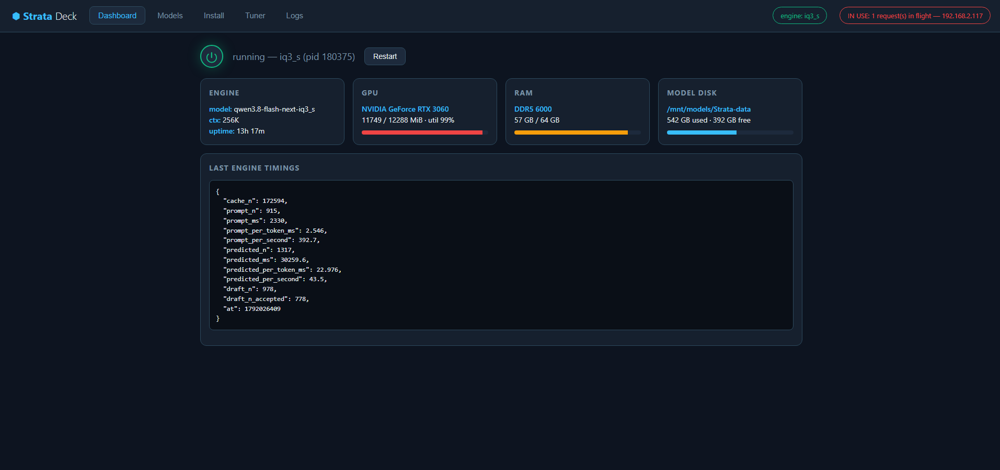
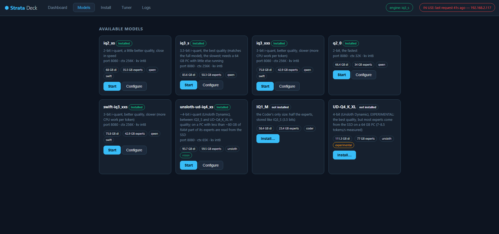
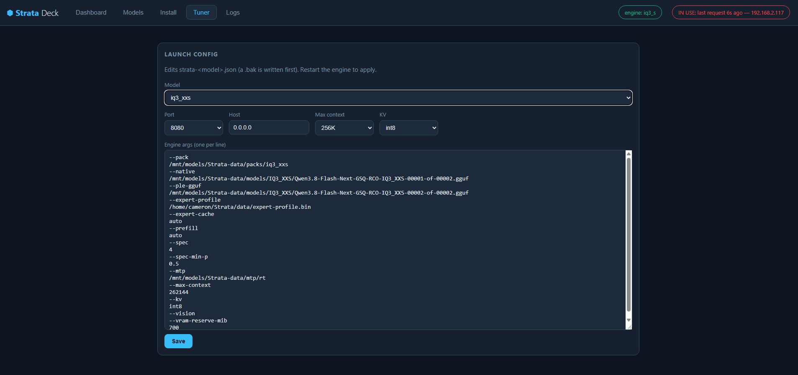

# Strata Deck

A web control panel for the [Strata](https://github.com/Niko1221/Strata) inference
engine — start/stop/switch models, tune launch configs, watch live engine stats,
and install new models from Hugging Face, all from a browser.

Built for self-hosted Strata boxes that serve real workloads (including live AI
agents) — the Deck is designed so an operator can never accidentally interrupt a
running session.





## Features

- **One-glance dashboard** — engine status, GPU/VRAM, RAM, model disk, live
  timings, and human-readable context/uptime.
- **Model grid** — installed and available models in a single card grid;
  installed cards get Start/Configure, uninstalled cards get Install.
- **IN USE guard** — the engine's own activity counters (`in_flight`,
  `last_request_at`) drive a live "IN USE" indicator. Stop/switch/restart
  refuse (fail-closed) while traffic is live unless you force it.
- **Consumer visibility** — recent clients of the serving chain are resolved
  to hostnames (reverse DNS) and shown in the IN USE pill, the restart
  confirm dialog, and the audit log. Know *who* you are about to interrupt.
- **Stale-path detector** — launch configs pointing at deleted/moved data
  directories are flagged red, and starting them requires an explicit force.
- **Validate-before-stop switching** — a doomed model switch can never leave
  you with no engine: the target config is validated before the running
  engine is touched.
- **Audit log** — every stop/switch/start records caller, decision, engine
  state, and consumer list (`deck-audit.log`).
- **Tuner** — edit `strata-<model>.json` from the browser (port dropdown
  filtered against ports actually in use, context/KV presets, raw args view).
  A `.bak` is written before every save.
- **Installer** — runs Strata's own `setup.py` (pinned HF revisions,
  resumable downloads) with live progress.

## Requirements

- A host running [Strata](https://github.com/Niko1221/Strata) (Linux, systemd
  user session). The Deck shells out to Strata's own `run-<model>.sh` and
  `setup.py` — it never talks to model files directly.
- Python 3.11+
- `ss` (iproute2) for port/consumer detection

## Quick start

```bash
python3 -m venv .venv
.venv/bin/pip install fastapi uvicorn
.venv/bin/uvicorn backend.main:app --host 0.0.0.0 --port 8090
```

Open `http://<host>:8090`.

### Configuration (environment)

| Variable | Default | Purpose |
|---|---|---|
| `STRATA_DIR` | `~/Strata` | Where Strata lives (`run-<model>.sh`, `strata-<model>.json`, `setup.py`) |
| `STRATA_SETTINGS` | `~/.config/strata/settings.json` | Strata's own settings file (data_dir) |
| `DECK_AUDIT` | `~/strata-deck/deck-audit.log` | Audit log location |

### systemd user service (recommended)

```ini
# ~/.config/systemd/user/strata-deck.service
[Unit]
Description=Strata Deck - web control panel for the Strata engine

[Service]
ExecStart=%h/strata-deck/.venv/bin/uvicorn backend.main:app --host 0.0.0.0 --port 8090
Restart=on-failure

[Install]
WantedBy=default.target
```

```bash
systemctl --user daemon-reload
systemctl --user enable --now strata-deck
```

## Architecture notes

- The Deck controls the engine through Strata's own scripts and its
  OpenAI-compatible `/v1/status` API — no engine internals are touched.
- **cgroup safety:** models are launched with `systemd-run --user
  --unit=strata-engine-<model>` so the serving chain lives in its own unit.
  Restarting the Deck never kills a running engine (and vice versa).
- **Two-process chain:** agent/API traffic flows through Strata's
  `serve/server.py` proxy before reaching the engine. Stopping the proxy
  drops client sessions even when the engine itself stays loaded — the IN
  USE guard exists precisely because this failure is invisible to
  process/GPU monitoring.
- API keys are read from `strata-<model>.json` at runtime and stripped from
  every response that reaches the browser.

## Relationship to Strata

Strata is the engine; Strata Deck is an independent add-on. It is not
officially affiliated with, endorsed by, or part of the Strata project.
MIT-licensed like upstream.

## License

MIT — see [LICENSE](LICENSE).
